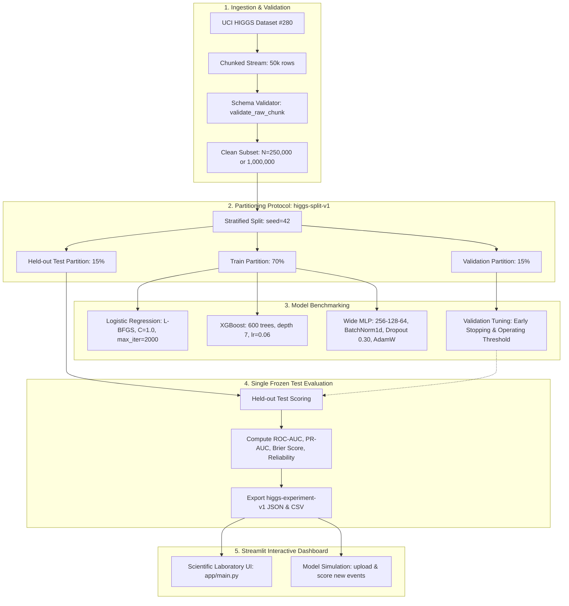

# HiggsEvent: Scientific Machine Learning Benchmark Laboratory

**A collaborative research benchmark comparing machine-learning representations on the simulated UCI HIGGS dataset (Baldi et al., 2014).**

> **Scientific Boundary:** This project classifies simulated collision events labeled as signal or background. It does **not** simulate quantum fields, establish a physical particle discovery, produce detector-grade analyses, or convert classifier scores into real-world Higgs probabilities. All results are empirical benchmarks on Monte Carlo simulation data.

---

## 1. Team & Ownership

| Name | Role | GitHub ID | Primary Responsibilities |
|---|---|---|---|
| **Krishna** | Team Lead | [`CosmicMagnetar`](https://github.com/CosmicMagnetar`) | Project scope, integration, split/evaluation protocol, deployment, presentation & viva prep |
| **Saumya Mishra** | Documentation & QA Lead | [`Saumya-Mishra-536`](https://github.com/Saumya-Mishra-536`) | Physics background, methodology, setup guide, bug triage, test plan, report review |
| **Aditya Rana** | Classical ML & Data Lead | [`A1B2C3D4E5F6G7H8I9J0164-hack`](https://github.com/A1B2C3D4E5F6G7H8I9J0164-hack`) | Chunked data loader, schema validation, EDA notebook, Logistic Regression baselines |
| **Rachit Gupta** | Deep Learning Lead | [`Rachitt19`](https://github.com/Rachitt19`) | Compact PyTorch MLP baseline, BatchNorm/Dropout, neural benchmarks, artifact export |
| **Ronit Singh** | Dashboard & UI Lead | [`ronithi27`](https://github.com/ronithi27`) | Streamlit scientific workbench, terminal HUD UI, artifact loader, Model Simulation view |

---

## 2. System Architecture



---

## 3. Benchmark Results

### Full-Dataset Benchmark (1,000,000 events)

Trained on the UCI HIGGS sample via `notebooks/03_full/00_full_higgs_colab.ipynb` using one frozen stratified split (seed 42, 15% validation, 15% test). All metrics computed on the held-out test partition ($N = 150{,}000$). Source: `outputs/full_colab_results.json`.

| Model | Test ROC-AUC | Test PR-AUC | Brier Score | Test Accuracy | Training Environment |
|---|---|---|---|---|---|
| Wide MLP (tuned) | 0.8399 | 0.8539 | 0.1630 | 0.7565 | Colab / Kaggle GPU (T4) |
| XGBoost (tuned) | 0.8271 | 0.8415 | 0.1693 | 0.7451 | Colab / Kaggle GPU (T4) |
| Logistic Regression (tuned) | 0.6834 | 0.6832 | 0.2233 | 0.6406 | Colab / Kaggle GPU (T4) |

**Best model:** Wide compact MLP (256-128-64, BatchNorm + Dropout, AdamW) achieves the highest discrimination (ROC-AUC 0.8399) and best calibration (Brier 0.1630). Saved model weights live in `outputs/model_weights/` (git-ignored; regenerate via the Colab notebook).

### Mid-Semester Benchmark (250,000 events)

Smaller-sample results from `notebooks/01_midsem/` for reference. Values come from serialized `higgs-experiment-v1` artifacts:

| Model | Feature Group | Features | Test ROC-AUC | Test PR-AUC | Brier Score |
|---|---|---|---|---|---|
| Logistic Regression | Low-level | 21 | 0.7476 | 0.7622 | 0.2035 |
| Logistic Regression | High-level | 7 | 0.7661 | 0.7427 | 0.1945 |
| Logistic Regression | All features | 28 | 0.8369 | 0.8377 | 0.1639 |
| Compact MLP | Low-level | 21 | 0.8000 | 0.8097 | 0.1824 |
| Compact MLP | High-level | 7 | 0.9043 | 0.8888 | 0.1184 |
| Compact MLP | All features | 28 | 0.9406 | 0.9372 | 0.0945 |

**Key finding:** Expert-derived high-level invariant masses strongly outperform raw low-level kinematics for both linear and neural classifiers. The wide tuned MLP on 1M events generalizes well (ROC-AUC 0.8399) on the larger sample.

---

## 4. Quickstart Guide

### 4.1 Environment Setup

```bash
# Clone the repository
git clone https://github.com/CosmicMagnetar/higgs-event-lab.git
cd higgs-event-lab

# Create and activate virtual environment
python3 -m venv .venv
source .venv/bin/activate

# Install dependencies and package in editable mode
pip install -r requirements.txt
pip install -e .
```

### 4.2 Download Data and Prepare a Sample

The notebooks download the original UCI HIGGS archive automatically when `data/raw/HIGGS.csv.gz` is missing. The first run downloads about 2.6 GB.

```bash
# Option A: Run the full-data Colab/Kaggle notebook
# Open notebooks/03_full/00_full_higgs_colab.ipynb in Colab or Kaggle

# Option B: Extract a 250k subset locally
python -m higgs_event_lab.data \
    --source data/raw/HIGGS.csv.gz \
    --output data/processed/higgs_sample_250k.csv.gz \
    --rows 250000
```

### 4.3 Train Benchmark Baselines

```bash
# Train Logistic Regression across all 3 feature groups
python -m higgs_event_lab.classical \
    --data data/processed/higgs_sample_250k.csv.gz \
    --all-groups \
    --output-dir outputs

# Train Compact MLP neural networks across all 3 feature groups
python -m higgs_event_lab.neural \
    --data data/processed/higgs_sample_250k.csv.gz \
    --all-groups \
    --output-dir outputs
```

### 4.4 Launch the Interactive Streamlit Dashboard

```bash
# Primary Scientific Laboratory Dashboard (recommended)
streamlit run app/main.py

# Alternative Retro Terminal HUD Dashboard
streamlit run app/streamlit_app.py
```

The app launches at `http://localhost:8501`. Use the sidebar to select artifact directories, rescan runs, and navigate between sections including **Model Simulation**, where you can upload a CSV and score events with the trained models.

### 4.5 Cloud Hosting (Streamlit Community Cloud)

The project is configured for one-click deployment on [Streamlit Community Cloud](https://share.streamlit.io/):
1. Connect repository `CosmicMagnetar/higgs-event-lab` on branch `main`.
2. Main file path: `streamlit_app.py`.
3. The app auto-initializes benchmark artifacts on first boot.

### 4.6 Run Automated QA & Test Suite

```bash
# Run all unit, integration, and hygiene tests
pytest

# Run dashboard-specific tests
pytest tests/unit/test_app_loader.py tests/unit/test_app_metrics.py -v
```

---

## 5. Repository Layout

| Folder | Purpose |
|---|---|
| `app/` | Streamlit dashboard application (views, components, loader, styles, visualizations) |
| `data/raw/` | Original UCI HIGGS download (git-ignored, local only) |
| `data/processed/` | Prepared subsets (250k, 1M; git-ignored except manifests) |
| `data/interim/` | Staged intermediate transformations (git-ignored) |
| `data/external/` | Auxiliary reference data (git-ignored) |
| `notebooks/` | Jupyter notebooks: physics intro, mid-sem EDA/MLP, full Colab benchmark |
| `outputs/` | Experiment artifacts: metrics.json, predictions, curves, results summary |
| `scripts/` | Data download, sample generation, full benchmark training |
| `src/higgs_event_lab/` | Reusable Python package: data, features, protocol, splits, evaluation, neural, classical, artifacts |
| `tests/` | Unit and integration tests with synthetic data |
| `docs/` | Project charter, data guide, setup guide, physics background, QA plan, ADRs |
| `reports/` | Methodology, neural benchmarks, classical benchmarks, presentation, viva guide |
| `deployment/` | Dockerfile, local deploy script, runbook |
| `team/` | Charter, backlog, changelog, meeting template |

---

## 6. Reports & Viva Pack

- [`reports/01_report_draft_methodology_limitations.md`](reports/01_report_draft_methodology_limitations.md) — Methodology, full-dataset benchmark results, validity threats and mitigations.
- [`reports/02_neural_network_benchmarks.md`](reports/02_neural_network_benchmarks.md) — Compact MLP architecture, regularization, cross-feature protocol.
- [`reports/03_classical_baseline_benchmarks.md`](reports/03_classical_baseline_benchmarks.md) — Logistic Regression pipeline, leakage-free scaling, cross-group benchmarks.
- [`reports/04_midsem_presentation_and_demo.md`](reports/04_midsem_presentation_and_demo.md) — 12-slide presentation structure and live demo script.
- [`reports/05_viva_defense_guide.md`](reports/05_viva_defense_guide.md) — Viva examination Q&A preparation pack (20 questions).

---

## 7. Notebook Run Order

Run the notebooks in this order:

1. `notebooks/00_physics/00_higgs_physics_and_dataset_intro.ipynb` — Beginner physics and dataset context.
2. `notebooks/01_midsem/01_eda_and_feature_groups.ipynb` — EDA on a 50k event sample.
3. `notebooks/01_midsem/02_neural_network_baseline.ipynb` — Compact MLP architecture and feature-group comparison.
4. `notebooks/03_full/00_full_higgs_colab.ipynb` — Full 1M benchmark on Colab/Kaggle (downloads data, trains models, exports artifacts).

Data sources:
- UCI dataset page: https://archive.ics.uci.edu/dataset/280/higgs
- Download zip: https://archive.ics.uci.edu/static/public/280/higgs.zip

---

## 8. Current Status: Mid-Semester Milestone Completed

- Chunked data extraction and schema validators verified.
- Exploratory data analysis notebook completed.
- Classical (Logistic Regression, XGBoost) and deep learning (Wide MLP) baselines benchmarked.
- Shared `higgs-split-v1` and `higgs-experiment-v1` protocols enforced.
- Streamlit scientific dashboard with Model Simulation view operating on real serialized artifacts.
- 104 of 104 automated tests passing.
- Presentation slide deck and viva examination defense pack ready.

---
