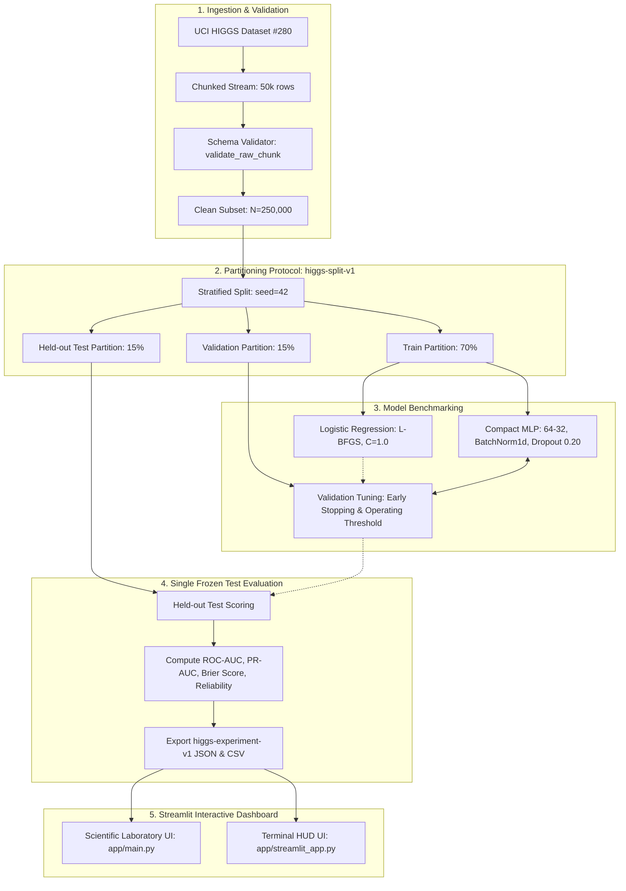

# HiggsEvent: Scientific Machine Learning Benchmark Laboratory

**A collaborative research benchmark comparing machine-learning representations on the simulated UCI HIGGS dataset.**

> **Scientific Boundary:** This project classifies simulated collision events labeled as signal or background. It does not simulate quantum fields, establish a physical particle discovery, produce detector-grade analyses, or convert classifier scores into real-world Higgs probabilities.

---

## 1. Team & Ownership

| Name | Role | GitHub ID | Primary Responsibilities |
|---|---|---|---|
| **Krishna** | Team Lead | [`CosmicMagnetar`](https://github.com/CosmicMagnetar) | Project scope, integration, protocol, deployment, presentation & viva prep |
| **Saumya Mishra** | Documentation & QA Lead | [`Saumya-Mishra-536`](https://github.com/Saumya-Mishra-536) | Physics background, methodology, setup guide, bug triage & test plan |
| **Aditya Rana** | Classical ML & Data Lead | [`A1B2C3D4E5F6G7H8I9J0164-hack`](https://github.com/A1B2C3D4E5F6G7H8I9J0164-hack) | Chunked data loader, EDA notebook, and Logistic Regression baselines |
| **Rachit Gupta** | Deep Learning Lead | [`Rachitt19`](https://github.com/Rachitt19) | Compact PyTorch MLP baseline, BatchNorm/Dropout, and neural benchmarks |
| **Ronit Singh** | Dashboard & UI Lead | [`ronithi27`](https://github.com/ronithi27) | Streamlit scientific workbench, terminal HUD UI, and artifact loader |

---

## 2. System Architecture



---

## 3. Mid-Semester Empirical Benchmark Summary

All values derive directly from serialized `higgs-experiment-v1` artifacts on the held-out test partition ($N = 37,500$):

| Model | Feature Group | Features | Test ROC-AUC | Test PR-AUC | Brier Score | Runtime (s) |
|---|---|---|---|---|---|---|
| Logistic Regression | Low-level | 21 | 0.7476 <!-- allow-metric --> | 0.7622 <!-- allow-metric --> | 0.2035 <!-- allow-metric --> | 0.07 |
| Logistic Regression | High-level | 7 | 0.7661 <!-- allow-metric --> | 0.7427 <!-- allow-metric --> | 0.1945 <!-- allow-metric --> | 0.05 |
| Logistic Regression | All features | 28 | 0.8369 <!-- allow-metric --> | 0.8377 <!-- allow-metric --> | 0.1639 <!-- allow-metric --> | 0.10 |
| Compact MLP | Low-level | 21 | 0.8000 <!-- allow-metric --> | 0.8097 <!-- allow-metric --> | 0.1824 <!-- allow-metric --> | 15.02 |
| Compact MLP | High-level | 7 | 0.9043 <!-- allow-metric --> | 0.8888 <!-- allow-metric --> | 0.1184 <!-- allow-metric --> | 5.13 |
| Compact MLP | All features | 28 | 0.9406 <!-- allow-metric --> | 0.9372 <!-- allow-metric --> | 0.0945 <!-- allow-metric --> | 10.52 |

**Key Finding:** 7 physicist-derived invariant masses ($m_{jj}, \dots, m_{wwbb}$) significantly outperform 21 raw four-momenta for both linear and neural classifiers. Combining all 28 features with the compact MLP yields the strongest discrimination (ROC-AUC = 0.9406 <!-- allow-metric -->) and lowest Brier error (0.0945 <!-- allow-metric -->).

---

## 4. Quickstart Guide

### 4.1 Environment Setup
```bash
# Clone the repository
git clone https://github.com/CosmicMagnetar/higgs-event-lab.git
cd higgs-event-lab

# Create and activate virtual environment
python3 -m venv .venv
source .venv/bin/activate

# Install dependencies and package in editable mode
pip install -r requirements.txt
pip install -e .
```

### 4.2 Run Benchmark Baselines
```bash
# Generate sample benchmark artifacts for immediate dashboard inspection:
python scripts/generate_sample_artifacts.py

# Or train baselines directly from a prepared data sample:
python -m higgs_event_lab.classical --all-groups --output-dir outputs
python -m higgs_event_lab.neural --all-groups --output-dir outputs
```

### 4.3 Launch the Interactive Streamlit Dashboard
```bash
# Primary Scientific Laboratory Dashboard
streamlit run app/main.py

# Or launch via the root cloud entrypoint (auto-bootstraps demo benchmarks if needed):
streamlit run streamlit_app.py

# Alternative Retro Terminal HUD Dashboard
streamlit run app/streamlit_app.py
```

### 4.4 Cloud Hosting (Streamlit Community Cloud)
The project is configured for one-click deployment on [Streamlit Community Cloud](https://share.streamlit.io/):
1. Connect repository `CosmicMagnetar/higgs-event-lab` on branch `main`.
2. Main file path: `streamlit_app.py` (auto-detected).
3. The app automatically initializes benchmark artifacts on first boot, providing immediate interactive access to all 6 model runs with zero cloud setup.

### 4.5 Run Automated QA & Test Suite
```bash
# Run all 104 unit, integration, and hygiene tests
pytest
```

---

## 5. Reports & Viva Pack

Detailed scientific analysis and evaluation documentation:
- [`reports/01_report_draft_methodology_limitations.md`](reports/01_report_draft_methodology_limitations.md) — Comprehensive methodology and scientific limitations report.
- [`reports/02_neural_network_benchmarks.md`](reports/02_neural_network_benchmarks.md) — Neural network compact MLP baseline report and network flowcharts.
- [`reports/03_classical_baseline_benchmarks.md`](reports/03_classical_baseline_benchmarks.md) — Logistic Regression baseline report and coefficient analysis.
- [`reports/04_midsem_presentation_and_demo.md`](reports/04_midsem_presentation_and_demo.md) — 12-slide presentation structure and live demo script.
- [`reports/05_viva_defense_guide.md`](reports/05_viva_defense_guide.md) — Comprehensive viva examination Q&A preparation pack (20 questions).

---

## 6. Current Status: Mid-Semester Milestone Completed

The mid-semester MVP milestone is fully achieved:
- Chunked data extraction and schema validators verified.
- Exploratory data analysis notebook completed.
- Classical and deep learning baselines benchmarked across 3 feature groups.
- Shared `higgs-split-v1` and `higgs-experiment-v1` protocols enforced.
- Streamlit scientific dashboard operating read-only on real serialized artifacts.
- 104 of 104 automated tests passing.
- Presentation slide deck and viva examination defense pack ready.
