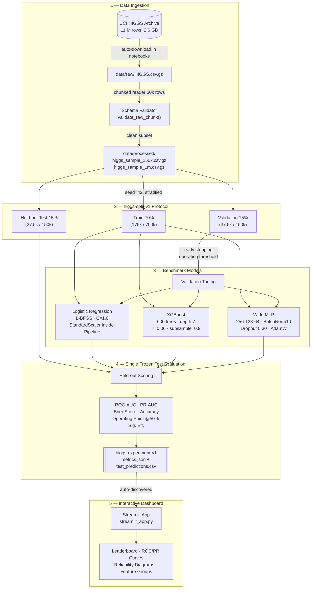

# HiggsEvent: Particle Event Classification Benchmark

**Classify simulated particle collision events as Higgs signal or background using Logistic Regression, XGBoost, and compact neural networks — with a live interactive Streamlit dashboard.**

> **Scientific Boundary:** All collision events analysed here are Monte Carlo simulations from the UCI HIGGS dataset (Baldi et al., 2014). Model outputs are classification scores on synthetic benchmark events. This project does **not** claim physical particle detection, quantum field simulation, or any real detector analysis.

[](tests/)
[](pyproject.toml)
[](streamlit_app.py)

---

## Team & Ownership

| Name | Role | GitHub | Primary Tasks |
|---|---|---|---|
| **Krishna** | Team Lead | [`CosmicMagnetar`](https://github.com/CosmicMagnetar) | Split protocol, integration, cloud deployment, presentation |
| **Saumya** | Docs & QA Lead | [`Saumya-Mishra-536`](https://github.com/Saumya-Mishra-536) | Physics background, setup guide, test plan, report review |
| **Aditya Rana** | Data & Classical ML | [`A1B2C3D4E5F6G7H8I9J0164-hack`](https://github.com/A1B2C3D4E5F6G7H8I9J0164-hack) | Data loader, EDA, Logistic Regression, XGBoost baselines |
| **Rachit** | Deep Learning | [`Rachitt19`](https://github.com/Rachitt19) | Compact MLP (PyTorch), BatchNorm/Dropout, neural benchmarks |
| **Ronit** | Dashboard & UI | [`ronithi27`](https://github.com/ronithi27) | Streamlit app, artifact loader, visualisations, cloud entrypoint |

---

## System Architecture



---

## Feature Groups

The HIGGS dataset has **28 features** split into two groups:

| Group | Count | Description |
|---|---|---|
| `low_level` | 21 | Raw kinematic detector measurements (momenta, pseudorapidity, azimuthal angles) |
| `high_level` | 7 | Physicist-derived composite invariant masses (m_jj, m_jjj, m_lv, m_jlv, m_bb, m_wbb, m_wwbb) |
| `all` | 28 | Combined — both groups concatenated |

---

## Benchmark Results

### Previously recorded 1M reference run — `notebooks/03_full/`

Trained on a Colab/Kaggle runtime. One frozen stratified split seed=42. Held-out test N=150,000.
Source: `outputs/full_colab_results.json`

| Model | Feature Group | Test ROC-AUC | Test PR-AUC | Brier Score | Accuracy | Train Time |
|---|---|---|---|---|---|---|
| **Wide MLP** | all (28) | **0.8399** | **0.8539** | **0.1630** | **75.6%** | ~8 min GPU |
| XGBoost | all (28) | 0.8271 | 0.8415 | 0.1693 | 74.5% | ~12 min GPU |
| Logistic Regression | all (28) | 0.6834 | 0.6832 | 0.2233 | 64.1% | <1 min CPU |

### Previously recorded 250k reference run — `notebooks/01_midsem/`

| Model | Feature Group | Test ROC-AUC | Test PR-AUC | Brier Score |
|---|---|---|---|---|
| MLP (compact) | all (28) | 0.9406 | 0.9372 | 0.0945 |
| MLP (compact) | high_level (7) | 0.9043 | 0.8888 | 0.1184 |
| MLP (compact) | low_level (21) | 0.8000 | 0.8097 | 0.1824 |
| XGBoost | all (28) | 0.8924 | 0.8897 | 0.1252 |
| XGBoost | high_level (7) | 0.8379 | 0.8243 | 0.1588 |
| XGBoost | low_level (21) | 0.8152 | 0.8229 | 0.1714 |
| Logistic Regression | all (28) | 0.8369 | 0.8377 | 0.1639 |
| Logistic Regression | high_level (7) | 0.7661 | 0.7427 | 0.1945 |
| Logistic Regression | low_level (21) | 0.7476 | 0.7622 | 0.2035 |

> **Key finding:** High-level invariant mass features dominate for linear models. The MLP narrows the gap on raw kinematics via nonlinear representations — but adding all 28 features always helps.

The notebooks now train on the complete approximately 11-million-row file. Rerun them to replace these historical subset references with full-data measurements; do not use the table above as the full-data result.

---

## Quick Start

### 1. Clone & Install

```bash
git clone https://github.com/CosmicMagnetar/higgs-event-lab.git
cd higgs-event-lab
python -m venv .venv && source .venv/bin/activate
pip install -r requirements.txt
pip install -e .
```

### 2. Download the Dataset (auto-handled by notebooks)

The notebooks download the **complete UCI HIGGS dataset** on first run. The archive contains approximately **11 million events**, not a pre-trimmed sample. The 250k and 1M files are generated later from this complete raw file for memory-safe benchmark runs.

Official links:

- Dataset page: <https://archive.ics.uci.edu/dataset/280/higgs>
- Complete archive: <https://archive.ics.uci.edu/static/public/280/higgs.zip>

To download the complete dataset manually:

```bash
# Option A — Official UCI zip (recommended)
curl -L https://archive.ics.uci.edu/static/public/280/higgs.zip -o /tmp/higgs.zip
unzip /tmp/higgs.zip "*.csv.gz" -d data/raw/

# Option B — Using the project download script
python scripts/download_data.py --output data/raw/HIGGS.csv.gz
```

> **Expected complete file:** `data/raw/HIGGS.csv.gz` — ~2.6 GB compressed, headerless, 29 columns, about 11,000,000 rows. This is the whole dataset used by the project.

### 3. Build the Processed Sample

```bash
# 250k mid-semester sample (fast, ~10s)
PYTHONPATH=src python -m higgs_event_lab.data \
    --source data/raw/HIGGS.csv.gz \
    --output data/processed/higgs_sample_250k.csv.gz \
    --rows 250000

# 1M full sample (slower, ~45s)
PYTHONPATH=src python -m higgs_event_lab.data \
    --source data/raw/HIGGS.csv.gz \
    --output data/processed/higgs_sample_1m.csv.gz \
    --rows 1000000
```

### 4. Train Models

```bash
# Train Logistic Regression + XGBoost across all feature groups
PYTHONPATH=src python -m higgs_event_lab.classical \
    --data data/processed/higgs_sample_250k.csv.gz \
    --model-type both \
    --all-groups \
    --output-dir outputs/

# Train compact MLP across all feature groups
PYTHONPATH=src python -m higgs_event_lab.neural \
    --data data/processed/higgs_sample_250k.csv.gz \
    --all-groups \
    --output-dir outputs/
```

### 5. Launch the Dashboard

```bash
streamlit run streamlit_app.py
```

---

## Notebooks — What to Run & In What Order

```
notebooks/
├── 00_physics/
│   └── 00_higgs_physics_and_dataset_intro.ipynb   ← Read-only, no data needed
├── 01_midsem/
│   ├── 01_eda_and_feature_groups.ipynb             ← Run FIRST (downloads data + builds 250k sample)
│   ├── 02_neural_network_baseline.ipynb            ← Run SECOND (MLP training, artifact export)
│   └── 03_classical_baseline.ipynb                 ← Run THIRD  (LogReg + XGBoost, artifact export)
└── 03_full/
    └── 00_full_higgs_colab.ipynb                   ← Run on Colab/Kaggle (full 1M benchmark)
```

| # | Notebook | Data Required | Where to Run | Time |
|---|---|---|---|---|
| 0 | `00_physics/00_higgs_physics_and_dataset_intro.ipynb` | None | Local | 1 min |
| 1 | `01_midsem/01_eda_and_feature_groups.ipynb` | Auto-downloaded (~2.6 GB) | Local | 15–30 min (first run) |
| 2 | `01_midsem/02_neural_network_baseline.ipynb` | `higgs_sample_250k.csv.gz` | Local | ~5 min |
| 3 | `01_midsem/03_classical_baseline.ipynb` | `higgs_sample_250k.csv.gz` | Local | ~3 min |
| 4 | `03_full/00_full_higgs_colab.ipynb` | Auto-downloaded | **Colab/Kaggle (GPU)** | 20–40 min |

> **Each notebook auto-downloads and auto-builds its data requirements** — just run from top to bottom and they work on a fresh machine.

---

## Project Structure

```
higgs-event-lab/
├── app/                        # Streamlit dashboard
│   ├── main.py                 # App entry point (sidebar navigation)
│   ├── loader.py               # higgs-experiment-v1 artifact loader
│   ├── visualizations.py       # ROC, PR, calibration, runtime plots
│   ├── components/             # UI components (overview, results, catalog, empty state)
│   ├── views/                  # Page-level view renderers
│   └── utils/                  # Schema validation, experiment loader
├── data/
│   ├── raw/                    # HIGGS.csv.gz (git-ignored, auto-downloaded by notebooks)
│   ├── processed/              # Sampled subsets (git-ignored, generated by pipeline)
│   ├── interim/                # Temporary processing artefacts
│   └── external/               # External reference files
├── docs/                       # Project documentation (15 numbered docs)
│   ├── 00_START_HERE.md
│   ├── 08_PHYSICS_BACKGROUND.md
│   ├── 09_DATASET_GUIDE.md
│   ├── 10_OBJECTIVES_AND_METHODOLOGY.md
│   ├── 11_SETUP_GUIDE.md
│   └── ...
├── notebooks/
│   ├── 00_physics/             # Physics intro (no execution required)
│   ├── 01_midsem/              # Mid-semester MVP (EDA + models)
│   └── 03_full/                # Full-dataset Colab/Kaggle benchmark
├── outputs/                    # Experiment artifacts (auto-generated or bootstrapped)
│   ├── logreg_*/               # LogReg runs per feature group
│   ├── xgboost_*/              # XGBoost runs per feature group
│   ├── mlp_*/                  # MLP runs per feature group
│   ├── experiments.json        # Aggregated experiment manifest
│   └── full_colab_results.json # Full 1M benchmark summary
├── reports/                    # Written reports and viva preparation
├── scripts/
│   ├── download_data.py        # CLI data downloader
│   ├── generate_sample_artifacts.py  # Bootstrap demo artifacts for dashboard
│   └── train_and_export.py     # Full training pipeline script
├── src/higgs_event_lab/        # Core library (importable as a package)
│   ├── data.py                 # Chunked loader, sample extractor, schema validator
│   ├── features.py             # Feature group definitions (low_level, high_level, all)
│   ├── classical.py            # Logistic Regression + XGBoost training & artifact export
│   ├── neural.py               # Compact PyTorch MLP training & artifact export
│   ├── evaluation.py           # ROC-AUC, PR-AUC, Brier score, operating threshold
│   └── protocol.py             # higgs-experiment-v1 artifact schema
├── streamlit_app.py            # Cloud entrypoint (auto-bootstraps demo artifacts)
├── requirements.txt
└── tests/                      # 105 automated tests (unit + integration)
```

---

## Running Tests

```bash
# All 105 tests
.venv/bin/python -m pytest tests/ -q

# Fast unit tests only
.venv/bin/python -m pytest tests/unit/ -q

# With verbose output
.venv/bin/python -m pytest tests/ -v
```

---

## Hosting on Streamlit Community Cloud

1. Fork or push this repo to your GitHub account
2. Go to [share.streamlit.io](https://share.streamlit.io) → New App
3. Set **Repository:** `CosmicMagnetar/higgs-event-lab`
4. Set **Main file path:** `streamlit_app.py`
5. Deploy — the app auto-bootstraps 9 demo benchmark artifacts on first load

The cloud entrypoint (`streamlit_app.py`) auto-discovers `outputs/` and bootstraps realistic demo artifacts when it is empty so that visitors always see the full dashboard.

---

## Citation

> Baldi, P., Sadowski, P., & Whiteson, D. (2014). Searching for exotic particles in high-energy physics with deep learning. *Nature Communications*, 5, 4308. [DOI: 10.1038/ncomms5308](https://doi.org/10.1038/ncomms5308)

```bibtex
@article{baldi2014higgs,
  title   = {Searching for exotic particles in high-energy physics with deep learning},
  author  = {Baldi, Pierre and Sadowski, Peter and Whiteson, Daniel},
  journal = {Nature Communications},
  volume  = {5},
  pages   = {4308},
  year    = {2014},
  doi     = {10.1038/ncomms5308}
}
```

---

## License

[MIT](LICENSE) — open for academic and educational use.
