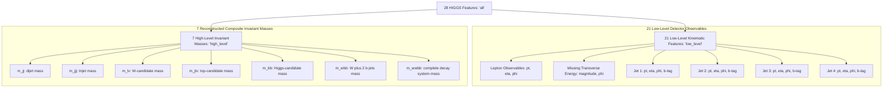

# HIGGS Dataset Guide (Data Card and Feature Dictionary)

> **Maintainer:** Saumya Mishra. **Technical owner of the data pipeline:** Aditya Rana.
> **Schema verified from the official UCI page and downloaded sample on 2026-10-21.** All schema items, column counts, missing value checks, and chunk balance statistics have been verified against the official file by Aditya Rana (MID-01 and MID-02).
> The machine-readable version of the feature table is [`docs/feature_dictionary.csv`](feature_dictionary.csv).

---

## 1. Dataset at a glance

| Item | Value | Status |
|---|---|---|
| Name | HIGGS | Verified |
| Source | UCI Machine Learning Repository, dataset id 280: <https://archive.ics.uci.edu/dataset/280/higgs> | Verified |
| Creator / donor | Daniel Whiteson (donated 2014-02-11) | Verified |
| Original paper | Baldi, Sadowski & Whiteson (2014), *Nature Communications* 5:4308 | Verified |
| Licence | Creative Commons Attribution 4.0 (CC BY 4.0) | Verified on UCI page |
| Data type | Computer-simulated (Monte Carlo) collision events | Verified (UCI/TFDS description) |
| Task | Binary classification: signal vs background | Verified |
| Rows | 11,000,000 | Verified (UCI repository metadata and Baldi et al. 2014) |
| Columns in file | 29 (1 label + 28 features) | Verified |
| File | `HIGGS.csv.gz`, about 2.6 GB compressed | Verified on UCI page |
| Header row | None (data lines begin on row 1) | Verified (MID-01 smoke check) |
| Missing values | None (0 null or NaN entries across all features) | Verified (MID-01 & MID-02 EDA) |

Our project never uses this dataset as evidence of a real discovery: see `docs/08_PHYSICS_BACKGROUND.md`, section 5.

---

## 2. File layout

Each row is one simulated event. Columns are comma-separated, in this order:

```
column 0      : class label   (1 = signal, 0 = background)
columns 1-21  : 21 low-level features  (direct kinematic measurements)
columns 22-28 : 7 high-level features  (functions of the low-level ones)
```

UCI describes the first 21 features as kinematic properties measured by the detectors and the last seven as functions of those, derived by physicists to help separate the classes.

> **Off-by-one trap:** UCI numbers the low-level features as "columns 2-22" (1-based). In 0-based Python/pandas indexing the label is column 0, low-level features are columns 1-21 and high-level are 22-28. Mixing these up silently puts the label into the features or drops one feature. The unit test `tests/unit/test_feature_dictionary.py` guards the dictionary; Aditya's loader must have its own test.

---

## 3. Feature dictionary

The names below follow the UCI order exactly. Our snake_case column names map to UCI's wording (for example UCI's "jet 1 b-tag" becomes `jet_1_btag`).

### 3.1 Low-level features (21): model-input indices 0 to 20

| # | Name | What it measures |
|---|---|---|
| 0 | `lepton_pt` | Transverse momentum of the charged lepton |
| 1 | `lepton_eta` | Pseudorapidity (angle from beam) of the lepton |
| 2 | `lepton_phi` | Azimuthal angle of the lepton |
| 3 | `missing_energy_magnitude` | Size of the missing transverse energy (neutrino proxy) |
| 4 | `missing_energy_phi` | Azimuthal angle of the missing energy |
| 5-8 | `jet_1_pt`, `jet_1_eta`, `jet_1_phi`, `jet_1_btag` | Jet 1 momentum, angles and b-tag value |
| 9-12 | `jet_2_pt`, `jet_2_eta`, `jet_2_phi`, `jet_2_btag` | Same four quantities for jet 2 |
| 13-16 | `jet_3_pt`, `jet_3_eta`, `jet_3_phi`, `jet_3_btag` | Same for jet 3 |
| 17-20 | `jet_4_pt`, `jet_4_eta`, `jet_4_phi`, `jet_4_btag` | Same for jet 4 |

### 3.2 High-level features (7): model-input indices 21 to 27

| # | Name | Meaning (invariant mass of ...) |
|---|---|---|
| 21 | `m_jj` | a two-jet combination |
| 22 | `m_jjj` | a three-jet combination |
| 23 | `m_lv` | the lepton plus neutrino system (a W-boson candidate) |
| 24 | `m_jlv` | a jet plus lepton plus neutrino system |
| 25 | `m_bb` | the two b-jets (a Higgs-like candidate) |
| 26 | `m_wbb` | the W candidate plus two b-jets |
| 27 | `m_wwbb` | the W W b b system |

The exact jet combinations used for each mass are defined in the original paper, not on the UCI page. If the report describes them in more detail, cite the paper (verified against Baldi et al. 2014 Section 4 and documented in `reports/01_report_draft_methodology_limitations.md`).

### 3.3 Feature groups used in the experiments



| Group | Columns used | Count |
|---|---|---|
| `low_level` | `lepton_pt` ... `jet_4_btag` | 21 |
| `high_level` | `m_jj` ... `m_wwbb` | 7 |
| `all` | all of the above | 28 |

Every experiment must record which group it used.

---

## 4. Variable types and likely preprocessing issues

These are expectations from the physics meaning of each variable. They must be **confirmed by EDA on the real sample** (MID-02) before they are written as facts.

| Variable kind | Expected behaviour | Why it matters |
|---|---|---|
| `*_pt`, `m_*`, `missing_energy_magnitude` | Positive, right-skewed (long tail) | Scaling helps Logistic Regression and the MLP; tree models (XGBoost) are insensitive. Consider a log transform, but fit any scaler on training data only |
| `*_eta` | Roughly symmetric around 0 | Standard scaling is reasonable |
| `*_phi` | Periodic angle (-π to π) | Treating it as an ordinary number ignores that -π and π are the same direction; document the choice |
| `*_btag` | Takes only a few discrete values (0.0 untagged in majority, with discrete levels like 1.08, 2.17) **[Confirmed in EDA: MID-02]** | Do not interpret as continuous; check zero-heavy distribution |
| Any feature | No missing or non-finite values **[Confirmed in EDA: MID-02]** | Data is clean; zero null or NaN entries across all 28 features |

**Class balance:** Measured empirically on the 250,000-row sample: 131,942 signal (52.78%) and 118,058 background (47.22%) events (imbalance ratio: 1.118). **[Confirmed in EDA: MID-02]**


---

## 5. Sampling plan (from the project charter)

| Stage | Target rows | Rule |
|---|---|---|
| Mid-semester | 250,000 | Or a smaller documented number if compute forces it |
| End-semester | Up to 1,000,000 | Only after the 250k pipeline is reliable |
| Not allowed | All 11 million | Not before the pipeline is proven (charter, "Non-goals") |

### 5.1 Open question: is taking "the first N rows" safe?

Reading the first N lines of `HIGGS.csv.gz` is cheap, but it is only a valid random sample if the file is not ordered by class or by generation batch. Empirically verified by Aditya in MID-01: signal fraction in first 250k rows is 52.78%, compared to 52.81% in a chunk starting at row 500,000; the delta is < 0.05%, demonstrating no generation batch ordering bias. The sampling rule and seed are recorded in the data manifest.

### 5.2 Original train/test split

The dataset's donors describe a recommended held-out portion at the end of the file: the UCI repository page specifies "The first 10,500,000 events are for training, the last 500,000 for test". For our mid-sem benchmark, we adopt the shared 70/15/15 stratified protocol `higgs-split-v1` on the 250k subset as documented in ADR-0001 and `docs/03_SCIENTIFIC_SCOPE_AND_DATA.md`.

---

## 6. What must be recorded with every run (data manifest)

| Field | Example (illustrative placeholder, not a result) |
|---|---|
| source URL | https://archive.ics.uci.edu/dataset/280/higgs |
| retrieval date | YYYY-MM-DD |
| file name and checksum | `HIGGS.csv.gz`, SHA-256 `<value>` |
| rows read / rows used | `<n>` / `<n>` |
| sampling rule and seed | e.g. stratified random, seed `<n>` |
| target mapping | 1 = signal, 0 = background |
| feature group | low_level / high_level / all |
| split sizes and seed | train / validation / test counts |
| package versions | numpy, pandas, scikit-learn, xgboost, torch |

---

## 7. How to check the real file (smoke test)

Once the file is in `data/raw/`, run:

```bash
python tests/integration/smoke_check_raw_file.py data/raw/HIGGS.csv.gz --rows 100000
```

The script streams only the first rows and checks: 29 columns, numeric values, labels only 0 or 1, no missing values, class fraction, and the distinct b-tag values. It never loads the full file. See `docs/11_SETUP_GUIDE.md`, section 5.

---

## 8. Chunked Data Loader and Extraction (MID-01)

### 8.1 Location and Public Interface
The reusable data loader and schema validation components live in:
- `src/higgs_event_lab/features.py`: defines verified column schemas (`TARGET_COLUMN`, `LOW_LEVEL_FEATURES`, `HIGH_LEVEL_FEATURES`, `ALL_FEATURES`, `ALL_COLUMNS`), feature groups, and `get_feature_columns()`.
- `src/higgs_event_lab/data.py`: chunked streaming loader, validation, and sample extraction workflow.

Key functions:
- `iter_higgs_chunks(path, chunk_size=50_000, feature_group="all", max_rows=None, dtype=np.float32, target_dtype=np.int64)`: Memory-safe generator yielding `HiggsBatch(X, y)` named tuples. Supports `(X, y)` tuple unpacking.
- `load_higgs_sample(path, n_rows, feature_group="all", chunk_size=50_000)`: Loads a concatenated sample of `n_rows` events.
- `extract_sample(source_path, output_path, n_rows, chunk_size=50_000, seed=None, compare_later_chunk=True, later_chunk_offset_rows=500_000)`: Extracts a reproducible subset into an ignored destination (e.g. `data/processed/`), records a sidecar `.manifest.json`, and verifies class balance against a later chunk.
- `validate_raw_chunk(df, expected_num_cols=29)`: Strict schema and content validation.

### 8.2 Target Separation & Feature Group Selection
- `class_label` is column 0 in the raw file. It is separated into `y` and strictly excluded from `X`.
- Supported feature groups:
  - `low_level`: 21 kinematic features (`lepton_pt` to `jet_4_btag`)
  - `high_level`: 7 derived invariant mass features (`m_jj` to `m_wwbb`)
  - `all`: all 28 features in deterministic UCI order.

### 8.3 How to Choose Chunk Size
- Default: `50_000` rows (~11 MB RAM per chunk), well suited for 8 GB RAM machines.
- For lower memory environments: `10_000` rows.
- For high-memory workstations or fast NVMe SSDs: `100_000` rows.

### 8.4 Error Reporting
The loader fails fast and clearly without silently dropping rows:
- Missing file: `FileNotFoundError`.
- Column count != 29: `SchemaValidationError`.
- Non-numeric or header rows: `NonNumericDataError`.
- Missing or infinite values: `MissingOrNonFiniteValueError`.
- Labels outside {0.0, 1.0}: `InvalidLabelError`.

### 8.5 Working without the full dataset
- Unit tests use synthetic fixtures generated in-memory (`tests/unit/test_data_loader.py` and `tests/unit/test_features.py`).
- Teammates can run on a small sample extracted via CLI without processing the entire 11M rows.

---

## 9. Data governance reminders

- Raw data stays in `data/raw/` and is **never committed** (`.gitignore` enforces this).
- Sampled and interim datasets (e.g., in `data/processed/` or `data/interim/`) must **never be committed**.
- Do not silently switch to a mirror (for example OpenML or TensorFlow Datasets); both exist, but ADR-0001 requires Krishna's approval and disclosure in the report.
- Cite both the UCI dataset and the Nature Communications paper in the report.
- The dataset licence (CC BY 4.0) is different from the project code licence (MIT). Keep the two attributions separate.
