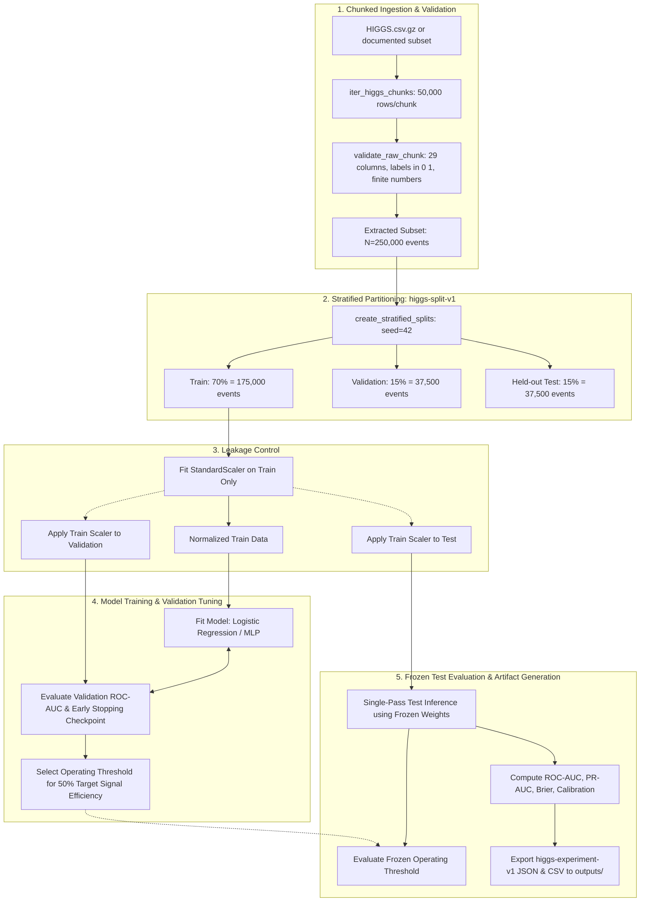

# Project Objectives and Methodology

> **Maintainer:** Saumya Mishra. **Protocol owner:** Krishna.
> This document specifies the scientific objectives, experimental matrix, data-splitting protocol, and metric standards agreed upon and confirmed for the project.
> No numeric results appear in this file. Results exist only in saved run artifacts.

---

## 1. Problem statement

Classify simulated particle-collision events as **signal** or **background** using the UCI HIGGS dataset, and determine which combination of *feature group* and *model family* performs best, at what compute cost, and how trustworthy the scores are.

## 2. Research question

> How do low-level kinematic features, seven expert-derived high-level features, and their combination affect the performance and compute cost of classical ML models (Logistic Regression, XGBoost) versus a compact neural network (MLP with batch normalization and dropout) on a documented HIGGS sample?

## 3. Objectives

### 3.1 Primary (required by the course brief)

| ID | Objective | Measurable success condition |
|---|---|---|
| O1 | Build a reproducible data pipeline for a documented HIGGS subset (250k to 1M rows) | Source, row count, seed, split recorded; no data committed |
| O2 | Compare three feature groups: 21 low-level, 7 high-level, 28 all | All three groups evaluated for each model, or missing ones stated explicitly |
| O3 | Train Logistic Regression and XGBoost baselines | Both evaluated on the same held-out test set |
| O4 | Train a compact MLP with batch normalization and dropout | Configuration, seed, device, epochs and runtime recorded |
| O5 | Evaluate fairly on held-out data | ROC-AUC, PR-AUC, calibration and training time reported for every experiment |
| O6 | Document limitations honestly | Limitations section present; no claims of discovery |

### 3.2 Secondary (project extensions, not required claims)

| ID | Objective | Note |
|---|---|---|
| O7 | Validation-selected operating point: for a declared target signal efficiency, report background rejection on test | This is **not** discovery significance |
| O8 | Uncertainty for the main comparison (repeat seeds and/or bootstrap) | Only if runtime allows |
| O9 | Read-only dashboard that shows saved experiment results | Never trains on startup; honest empty state |

### 3.3 Non-goals

Proving the Higgs boson exists, simulating the Higgs field, claiming real-data discovery, producing detector-grade performance, claiming real-world calibrated probabilities, or training on all 11 million rows before the small pipeline is correct (charter, "Non-goals").

---

## 4. Experimental design

### 4.1 Experiment matrix

3 feature groups x 3 models = **9 experiments** (per seed).

| | Logistic Regression | XGBoost | MLP |
|---|---|---|---|
| `low_level` (21) | E1 | E2 | E3 |
| `high_level` (7) | E4 | E5 | E6 |
| `all` (28) | E7 | E8 | E9 |

Mid-semester scope (per the milestones): Logistic Regression and MLP first, XGBoost added for end-semester (backlog `END-01`). Missing cells must be listed as "not run" in the report, never left blank or filled.

### 4.2 Pipeline (the same for every experiment)



```
 1. Load      -> read a documented subset in chunks (never the full file at once)
 2. Validate  -> check 29 columns, labels in {0,1}, no NaN, feature order == feature_dictionary.csv
 3. Separate  -> split label y from features X; select the feature group
 4. Split     -> stratified train / validation / test with a fixed seed   (done BEFORE any fitting)
 5. Preprocess-> fit scaler/imputer on TRAIN only; apply to validation and test
 6. Train     -> fit the model on TRAIN; early stopping / tuning uses VALIDATION only
 7. Threshold -> (extension) choose operating threshold on VALIDATION only
 8. Evaluate  -> score the untouched TEST set exactly once for the final choices
 9. Save      -> write metrics, run metadata and predictions in the agreed artifact schema
10. Report    -> tables/figures generated from saved artifacts only
```

### 4.3 Split protocol (Confirmed: `higgs-split-v1`)

- Stratified random split on the binary label.
- **70 % train / 15 % validation / 15 % test** of the chosen subset (175k train / 37.5k val / 37.5k test for 250k rows).
- Global split seed is **42**, recorded; the *same split indices* are reused by all experiments so that comparisons are fair.
- Governed by `src/higgs_event_lab/protocol.py` and guarded by `tests/unit/test_protocol.py`.

### 4.4 Models

| Model | Role | Key settings to record |
|---|---|---|
| Logistic Regression | Linear baseline | solver (L-BFGS), regularization strength (C=1.0), max iterations (1000), scaler |
| XGBoost | Strong tree-ensemble baseline | number of trees, depth, learning rate, early-stopping rounds, number of threads |
| MLP (PyTorch) | Compact neural network with **batch normalization and dropout** | layer sizes (64, 32), dropout rate (0.20), optimizer (AdamW), learning rate (1e-3), batch size (1024), early-stopping patience (5), device (CPU) |

**Fair-comparison rule:** each model gets a comparable, documented tuning budget on the *validation* set (for example the same number of trials). A tuned XGBoost against an untuned Logistic Regression would be an unfair comparison and must be stated if it happens.

### 4.5 Metrics

| Metric | Definition (plain language) | Why it is included |
|---|---|---|
| **ROC-AUC** | Chance that a random signal event outranks a random background event | Threshold-free ranking quality |
| **PR-AUC / average precision** | Area under the precision-recall curve | Focuses on precision for the positive class |
| **Brier score** | Mean squared difference between predicted probability and true 0/1 label (lower is better) | Single-number probability quality |
| **Calibration curve** | Predicted-probability bins versus observed signal fraction | Shows whether scores behave like probabilities |
| **Training time** | Wall-clock seconds to fit (record hardware, threads, device) | Compute trade-off |
| **Inference time** | Seconds to score the test set (if feasible) | Deployment cost |
| **Accuracy** | Reported only as a secondary figure | Insufficient alone (docs/03) |

**Operating-point extension (O7):** choose a declared target signal efficiency of **0.50 (50%)**. On the validation set find the threshold that achieves it. Freeze the threshold. On the test set report:

- signal efficiency = TP / (TP + FN),
- background rejection = TN / (TN + FP) = 1 - false-positive rate.

### 4.6 Repeats and uncertainty

- Primary experiments are repeatable with seed 42, and repeated-seed comparisons report mean and spread.
- Bootstrap confidence intervals for test ROC-AUC are calculated on the primary comparison.
- Differences smaller than the observed spread must not be described as "better".

---

## 5. Leakage and integrity controls

| Risk | Control | Who checks |
|---|---|---|
| Label inside features | Dedicated label/feature separation test | Aditya writes, Saumya verifies |
| Scaler fitted on test data | Split first, fit on train only; test with a synthetic dataset | Aditya, Rachit |
| Hyperparameters tuned on test | Tuning uses validation only; test evaluated once | Krishna review |
| Different test sets per model | One shared split file/seed | Krishna |
| Fabricated or copied metrics | Report tables generated from saved artifacts; repo hygiene test scans for suspicious numbers | Saumya |
| Hidden data source change | Source/URL and row count recorded in every artifact | Saumya |
| Duplicate rows across splits | Split by row index before any resampling; no oversampling before splitting | Aditya |

---

## 6. Reproducibility requirements

Every run stores: dataset source, retrieval date, file checksum, sampled row count, sampling rule, class balance, split seed and sizes, feature group, model and hyperparameters, training seed, library versions, hardware/device, training and inference time, and the exact command or notebook used. A new teammate must be able to reproduce a starter run by following `docs/11_SETUP_GUIDE.md` only.

---

## 7. Roles in the methodology

| Step | Owner | Reviewer |
|---|---|---|
| Data loading, validation, EDA, Logistic Regression, XGBoost | Aditya | Rachit |
| MLP training and metadata | Rachit | Aditya |
| Split, metric and artifact contracts; operating-point analysis | Krishna | Aditya, Rachit |
| Dashboard | Ronit | Krishna |
| Methodology text, QA, known issues, change log | Saumya | all owners |

---

## 8. Mapping to deliverables

| Stage | What this methodology must deliver | Source |
|---|---|---|
| Mid-semester | Documented source/row count, feature-group experiments as runtime allows, fair evaluation, ROC-AUC and average precision, calibration and training time where implemented, limitations, reproducible demo | `docs/05` |
| End-semester | XGBoost, validation-selected threshold analysis, repeated seeds, dashboard on real artifacts, full report | `docs/05`, `team/TASK_BACKLOG.csv` |
