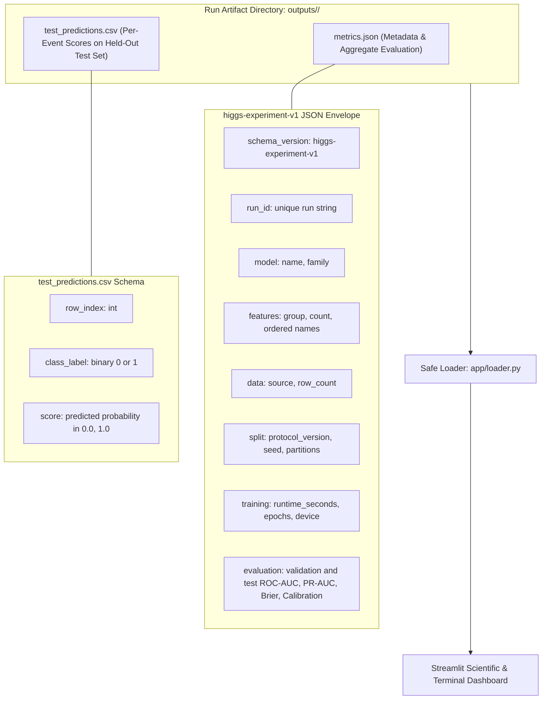

# Experiment Protocol and Artifact Contract

**Owner:** Krishna. **Applies to:** Aditya's classical baselines, Rachit's MLP, and Ronit's dashboard.

## Fixed comparison protocol

Every comparison run must start from the same documented subset and use `higgs-split-v1`:

- binary labels are split stratified with the declared seed;
- the default partition is train, validation, and test at 70%, 15%, and 15%;
- only training rows fit scalers, imputers, model weights, or class weighting;
- validation selects epochs, hyperparameters, and any operating threshold;
- the test partition is held back until the model choice is frozen;
- all models in a comparison use the identical saved row indices.

The default seed is 42. A different seed is allowed only when it is recorded in the resulting artifact. Repeated-seed studies must list every seed and aggregate rule; a single run must never be presented as a stability estimate.

## `higgs-experiment-v1` JSON envelope

Each run writes `metrics.json` under an ignored output directory. It has these required top-level keys:

| Key | Meaning |
| --- | --- |
| `schema_version` | Must be `higgs-experiment-v1`. |
| `run_id` | Unique local run identifier. |
| `model` | Model name and family. |
| `features` | Group, ordered feature names, and count. |
| `data` | Source path and actual number of events. |
| `split` | Protocol version, seed, fractions, and partition sizes. |
| `training` | Configuration, runtime, device, parameter count where applicable, and learning history. |
| `evaluation` | Separate validation and test ROC-AUC, PR-AUC, Brier score, and calibration points. |

The same directory also contains `test_predictions.csv` with `row_index`, `class_label`, and `score`. Scores are classifier outputs for simulated events, not physical Higgs probabilities. Files are local experiment outputs and are intentionally ignored by Git.

## Acceptance checks before dashboard integration

- Reject artifacts with an unknown schema version or missing required keys.
- Display the data source, event count, seed, feature group, and split beside every comparison.
- Do not mix validation and test metrics in a chart.
- Do not display metrics when no valid artifact is available.
- Retain the original artifact when exporting dashboard results.
