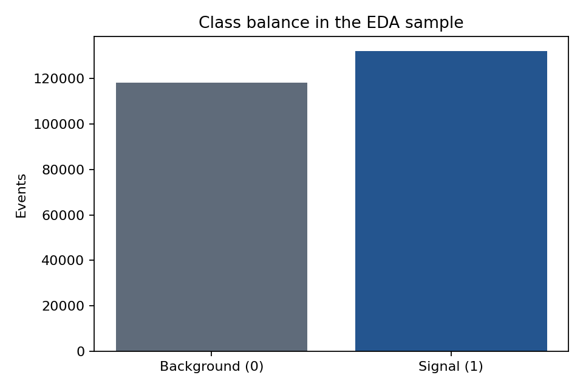
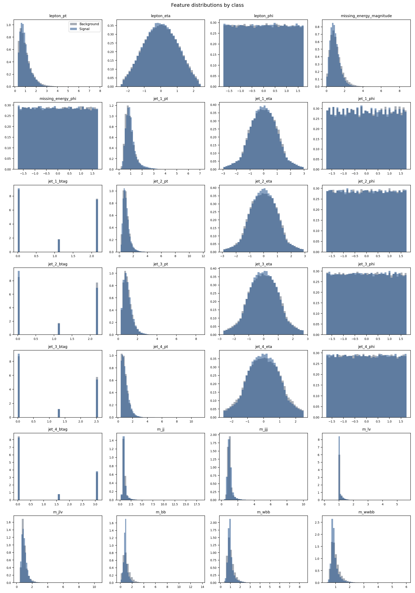
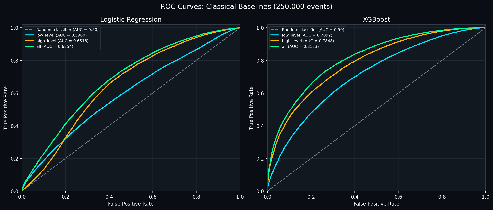
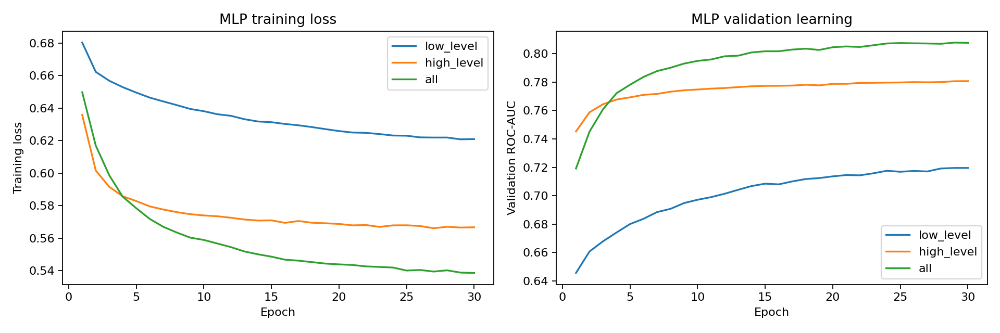
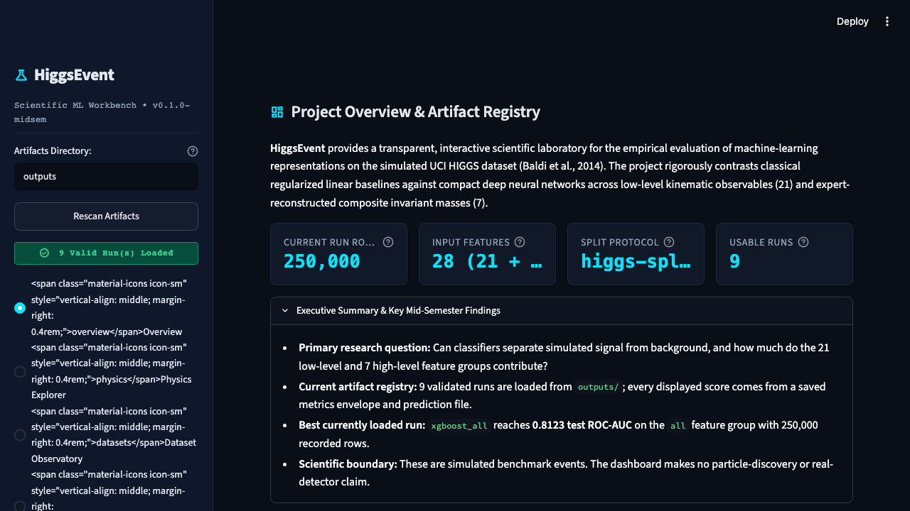

% HiggsLens
% Machine-learning classification of simulated HIGGS events
% Final artifact-backed presentation

# Project in one sentence

- Reproducible benchmark for classifying simulated HIGGS signal versus background events.
- Compares Logistic Regression, XGBoost and a compact PyTorch MLP.
- Dashboard consumes saved artifacts; it never trains at startup.

> **Boundary:** simulated benchmark only — no particle-discovery claim.

# Dataset and scientific question

- UCI HIGGS dataset, approximately 11 million source events.
- 28 inputs: 21 low-level kinematic features + 7 high-level invariant masses.
- Current saved benchmark: 250,000 rows, seed 42, 70/15/15 split.
- Question: do engineered invariant masses add measurable value, and can nonlinear models learn useful structure from raw kinematics?



# End-to-end pipeline

1. Download complete archive directly from UCI.
2. Validate schema, labels and finite values in chunks.
3. Create the fixed stratified split.
4. Fit preprocessing on training rows only.
5. Train models and select threshold on validation data.
6. Export metrics and predictions.
7. Explore the results in Streamlit.

# Exploratory evidence



- Saved EDA: 250,000 rows.
- Missing values: 0.
- Non-finite values: 0.
- Strongest saved correlation: `m_wbb` with `m_wwbb`.

# Model design

**Logistic Regression**

- L-BFGS, `C=1.0`, training-only StandardScaler.

**XGBoost**

- 150 trees, depth 6, learning rate 0.1, histogram method.

**Compact MLP**

- Hidden widths 64 → 32.
- BatchNorm + ReLU + dropout 0.20.
- AdamW, learning rate 1e-3, early stopping on validation ROC-AUC.

# Current leaderboard

| Model | Feature group | ROC-AUC | PR-AUC | Brier |
|---|---|---:|---:|---:|
| XGBoost | `all` | 0.8123 | 0.8266 | 0.1765 |
| Compact MLP | `all` | 0.8121 | 0.8270 | 0.1767 |
| XGBoost | `high_level` | 0.7848 | 0.8026 | 0.1882 |
| Compact MLP | `high_level` | 0.7832 | 0.8020 | 0.1892 |
| Compact MLP | `low_level` | 0.7257 | 0.7366 | 0.2113 |
| XGBoost | `low_level` | 0.7092 | 0.7233 | 0.2165 |
| Logistic Regression | `all` | 0.6854 | 0.6817 | 0.2231 |
| Logistic Regression | `high_level` | 0.6518 | 0.6217 | 0.2315 |
| Logistic Regression | `low_level` | 0.5960 | 0.6222 | 0.2418 |

**Current headline:** XGBoost on `all` features, ROC-AUC **0.8123**.

# Feature-group finding



- Low-level-only models are weakest in the current registry.
- High-level invariant masses provide a stronger compact representation.
- Combining all 28 features gives the strongest result for each model family.

# Neural training evidence



- The learning curve is loaded from genuine per-epoch history in `outputs/mlp_all/metrics.json`.
- No synthetic training history is used.

# Operating-point view

- Threshold is selected on validation data for a 50% signal-efficiency target.
- It is frozen before test evaluation.
- Background rejection is reported as a benchmark metric, not a significance estimate.
- The dashboard exposes an interactive threshold workbench over saved test predictions.

# HiggsLens Streamlit dashboard

```bash
streamlit run app/main.py
```

- Overview: artifact registry and current best run.
- Dataset Observatory: saved EDA tables and figures.
- Experiment Comparison: leaderboard, feature groups and runtime.
- Validation: ROC, PR, calibration, learning history and thresholds.
- Methods and Research: protocol, references and limitations.



# Reproducibility and checks

- Artifact contract: `higgs-experiment-v1`.
- Split protocol: `higgs-split-v1`, seed 42.
- Current test result: **105 passed**.
- Raw data is downloaded from UCI at runtime and is not committed.

# Limitations and conclusion

- HIGGS events are simulated Monte Carlo events.
- The class balance is not representative of real rare-event searches.
- Current saved metrics cover the 250,000-row benchmark; the historical 1M summary is kept separate because it used a different pipeline and copied timing values.
- HiggsLens is an engineering and benchmark study, not a physics-discovery analysis.

**Takeaway:** the artifact-backed system works end to end, and the dashboard, report and slides now use the same saved evidence.
