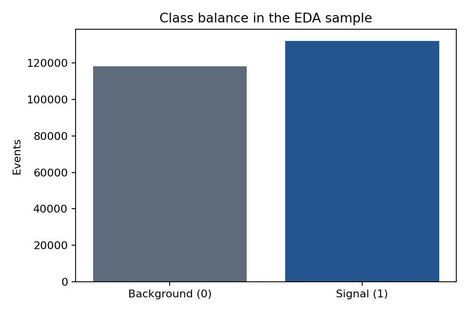
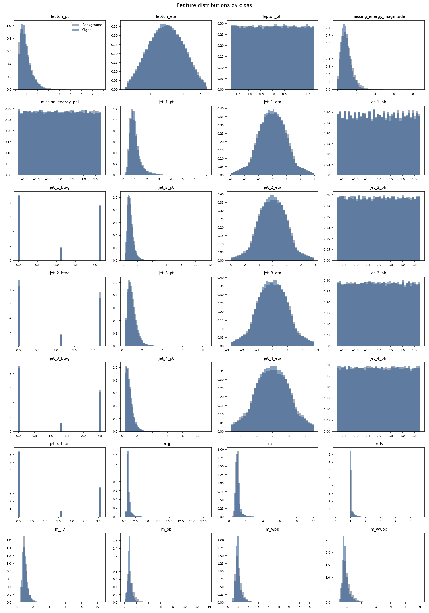
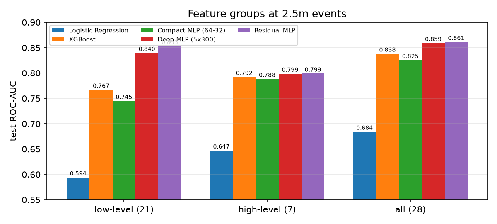
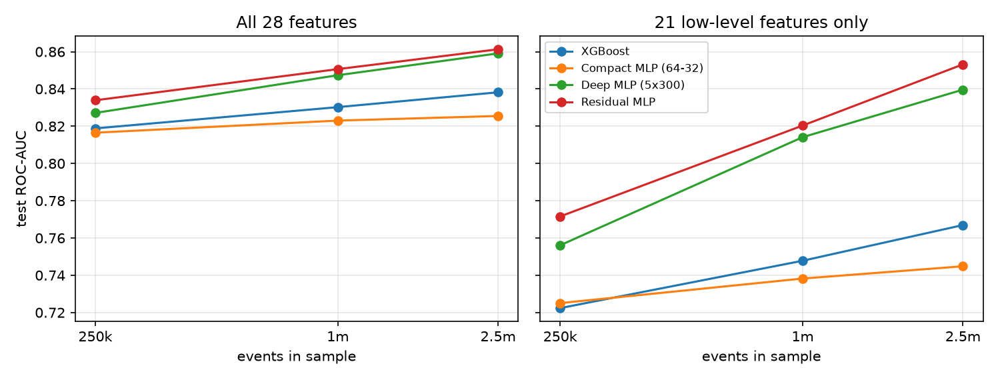
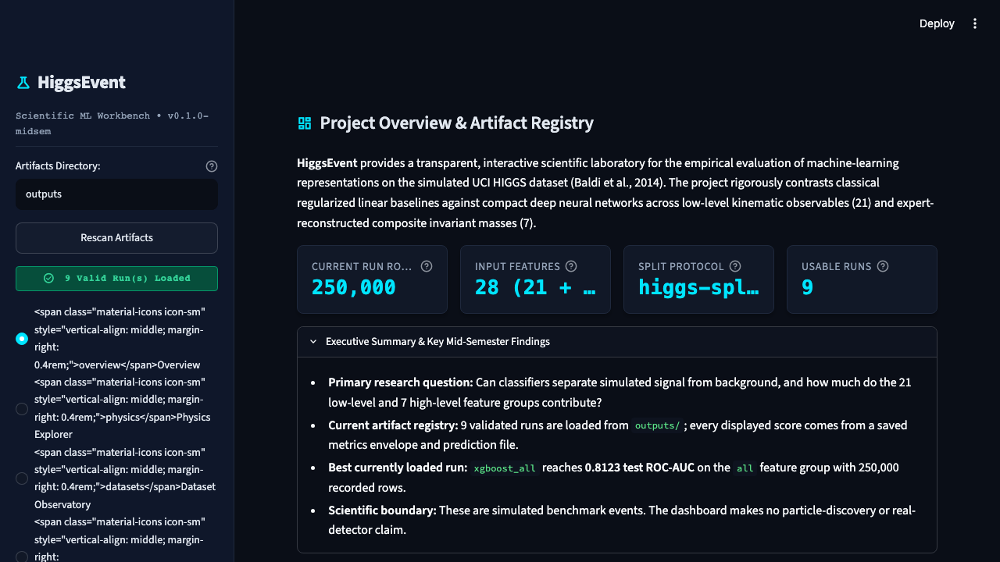

% HiggsLens
% Machine-learning classification of simulated HIGGS events
% Final artifact-backed presentation

# Project in one sentence

- Reproducible benchmark for classifying simulated HIGGS signal versus background events.
- Compares Logistic Regression, XGBoost and a compact PyTorch MLP.
- Dashboard consumes saved artifacts; it never trains at startup.

> **Boundary:** simulated benchmark only — no particle-discovery claim.

# Dataset and scientific question

- UCI HIGGS dataset, approximately 11 million source events.
- 28 inputs: 21 low-level kinematic features + 7 high-level invariant masses.
- Current saved benchmark: 250,000 rows, seed 42, 70/15/15 split.
- Question: do engineered invariant masses add measurable value, and can nonlinear models learn useful structure from raw kinematics?



# End-to-end pipeline

1. Download complete archive directly from UCI.
2. Validate schema, labels and finite values in chunks.
3. Create the fixed stratified split.
4. Fit preprocessing on training rows only.
5. Train models and select threshold on validation data.
6. Export metrics and predictions.
7. Explore the results in Streamlit.

# Exploratory evidence



- Saved EDA: 250,000 rows.
- Missing values: 0.
- Non-finite values: 0.
- Strongest saved correlation: `m_wbb` with `m_wwbb`.

# Model design

**Logistic Regression**

- L-BFGS, `C=1.0`, training-only StandardScaler.

**XGBoost**

- Depth 8, up to 3000 trees, early stopping on validation.

**Networks**

- Compact MLP 64 → 32 (mid-semester, shallow).
- Deep MLP 5 × 300 (Baldi et al. 2014).
- Residual MLP, 4 blocks of 256 (Gorishniy et al. 2021).

# Current leaderboard

| Model | Feature group | ROC-AUC | PR-AUC | Brier |
|---|---|---:|---:|---:|
| Residual MLP | `all` | 0.8339 | 0.8531 | 0.1660 |
| Deep MLP (5x300) | `all` | 0.8271 | 0.8464 | 0.1693 |
| XGBoost | `all` | 0.8188 | 0.8398 | 0.1727 |
| Compact MLP | `all` | 0.8165 | 0.8385 | 0.1746 |
| Residual MLP | `high_level` | 0.7945 | 0.8206 | 0.1835 |
| Deep MLP (5x300) | `high_level` | 0.7945 | 0.8204 | 0.1836 |
| XGBoost | `high_level` | 0.7852 | 0.8117 | 0.1873 |
| Compact MLP | `high_level` | 0.7846 | 0.8115 | 0.1881 |
| Residual MLP | `low_level` | 0.7716 | 0.7889 | 0.1969 |
| Deep MLP (5x300) | `low_level` | 0.7561 | 0.7755 | 0.2001 |
| Compact MLP | `low_level` | 0.7250 | 0.7486 | 0.2103 |
| XGBoost | `low_level` | 0.7223 | 0.7456 | 0.2107 |
| Logistic Regression | `all` | 0.6864 | 0.6944 | 0.2216 |
| Logistic Regression | `high_level` | 0.6466 | 0.6314 | 0.2307 |
| Logistic Regression | `low_level` | 0.5962 | 0.6369 | 0.2407 |

**Best at 250k:** Residual MLP on `all` features, ROC-AUC **0.8339**. The 2.5M results are on the next two slides.

# Feature-group finding



- Trees and the small MLP need the high-level invariant masses.
- The deep networks score higher on raw low-level features than XGBoost does on all 28.
- That is the paper's claim: depth lets the network learn the physics features itself.

# Why deep learning: it scales



- Same code, same seed, nested 250k ⊂ 1M ⊂ 2.5M samples.
- XGBoost and the compact MLP flatten; the deep and residual MLPs keep improving.
- Trade-off: the networks take minutes on a GPU, XGBoost seconds.

# Operating-point view

- Threshold is selected on validation data for a 50% signal-efficiency target.
- It is frozen before test evaluation.
- Background rejection is reported as a benchmark metric, not a significance estimate.
- The dashboard exposes an interactive threshold workbench over saved test predictions.

# HiggsLens Streamlit dashboard

```bash
streamlit run streamlit_app.py
```

- Overview: artifact registry and current best run.
- Dataset Observatory: saved EDA tables and figures.
- Experiment Comparison: leaderboard, feature groups and runtime.
- Validation: ROC, PR, calibration, learning history and thresholds.
- Methods and Research: protocol, references and limitations.



# Reproducibility and checks

- Artifact contract: `higgs-experiment-v1`.
- Split protocol: `higgs-split-v1`, seed 42.
- Latest QA-branch GitHub Actions: editable install and full pytest workflow passed on Python 3.11; Docker image build passed. See `docs/12_QA_TEST_PLAN.md` for commit and run links. The hosted log does not publish a test count.
- Raw data is downloaded from UCI at runtime and is not committed.

# Limitations and conclusion

- HIGGS events are simulated Monte Carlo events.
- The class balance is not representative of real rare-event searches.
- Current saved metrics cover the 250,000-row benchmark; the historical 1M summary is kept separate because it used a different pipeline and copied timing values.
- HiggsLens is an engineering and benchmark study, not a physics-discovery analysis.

**Takeaway:** the artifact-backed system works end to end, and the dashboard, report and slides now use the same saved evidence.
