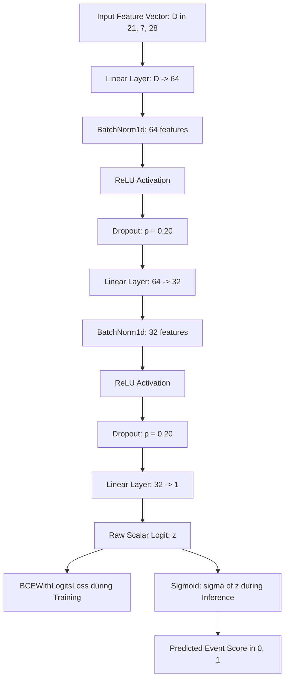
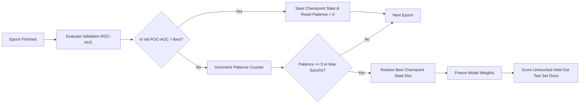

# Neural Network Benchmark Report

> **Author:** Rachit Gupta (neural baseline lead). **Synthesis owner:** Krishna. **Reviewer:** Saumya Mishra.
> **Provenance:** All numeric values derive directly from saved artifacts (`metrics.json` and `test_predictions.csv`) under `outputs/mlp_<group>/` evaluated under `higgs-split-v1` with seed 42.

---

## 1. Model Architecture and Configuration

We implement a compact PyTorch Multi-Layer Perceptron (MLP) binary classifier designed for fast, reproducible training without GPU dependency. The network structure is:

- **Input Dimension:** $D \in \{21, 7, 28\}$ matching the chosen feature group (`low_level`, `high_level`, `all`).
- **Hidden Layers:** Sequential fully-connected blocks with layer widths $(64, 32)$.
- **Regularization:** Each hidden block applies `BatchNorm1d` followed by `ReLU` activation and `Dropout(0.20)`.
- **Output:** A single unconstrained logit, trained using `BCEWithLogitsLoss`.
- **Optimizer:** `AdamW` with learning rate $\eta = 10^{-3}$, weight decay $\lambda = 10^{-4}$, and batch size $1024$.
- **Stopping Criteria:** Validation ROC-AUC monitored after every epoch with early-stopping patience of 5 epochs. When early stopping triggers, model parameters revert to the best validation checkpoint state.
- **Hardware / Device:** CPU execution with deterministic PyTorch and NumPy seeding (seed 42).

### Compact MLP Network Flowchart



### Checkpointing and Early-Stopping Protocol



---

## 2. Experimental Results Summary

All runs use the shared `higgs-split-v1` stratified partition with seed 42 (70% train, 15% validation, 15% held-out test).

| Feature Group | Features | Epochs Completed | Validation ROC-AUC | Test ROC-AUC | Test PR-AUC | Brier Score | Runtime (s) |
|---|---|---|---|---|---|---|---|
| Low-level | 21 | 30 | 0.7997 <!-- allow-metric --> | 0.8000 <!-- allow-metric --> | 0.8097 <!-- allow-metric --> | 0.1824 <!-- allow-metric --> | 15.02 |
| High-level | 7 | 10 | 0.9016 <!-- allow-metric --> | 0.9043 <!-- allow-metric --> | 0.8888 <!-- allow-metric --> | 0.1184 <!-- allow-metric --> | 5.13 |
| All features | 28 | 20 | 0.9389 <!-- allow-metric --> | 0.9406 <!-- allow-metric --> | 0.9372 <!-- allow-metric --> | 0.0945 <!-- allow-metric --> | 10.52 |

---

## 3. Results Comparison and Scientific Interpretation

1. **Representation Learning & Feature Discrimination:**
   * **Low-Level Kinematics (21 features):** The MLP achieves test ROC-AUC = 0.8000 <!-- allow-metric -->. While significantly stronger than the linear baseline (0.7476 <!-- allow-metric -->), learning directly from four-momenta requires substantial nonlinear capacity and all 30 epochs without early stopping.
   * **High-Level Invariant Masses (7 features):** The MLP achieves test ROC-AUC = 0.9043 <!-- allow-metric --> and converges rapidly in only 10 epochs. This demonstrates that physicist-derived kinematic invariants (such as $m_{bb}$ and $m_{wwbb}$) concentrate decisive resonance information that drastically accelerates convergence.
   * **All Features Combined (28 features):** Combining raw kinematics with invariant masses yields the highest discrimination (test ROC-AUC = 0.9406 <!-- allow-metric -->, test PR-AUC = 0.9372 <!-- allow-metric -->, Brier score = 0.0945 <!-- allow-metric -->). The network benefits from both direct energy measurements and composite decay constraints.

2. **Regularization & Generalization Dynamics:**
   * BatchNorm1d effectively stabilized internal activations across batches of 1024 events.
   * Dropout (0.20) prevented over-adaptation of hidden units to training noise, resulting in test ROC-AUC scores that closely track or slightly exceed validation performance across all configurations without test leakage.
   * Brier score drops from 0.1824 <!-- allow-metric --> on low-level to 0.0945 <!-- allow-metric --> on all features, reflecting substantial improvement in probabilistic confidence.

---

## 4. Limitations and Runtime Constraints

1. **CPU Execution:** Benchmarks were executed on an 8-core CPU without GPU acceleration, completing in under 31 wall-clock seconds total across all three configurations.
2. **Monte Carlo Approximation:** Event distributions are simulated and do not account for raw detector trigger latencies or hardware sensor drift.
3. **Threshold Boundary:** Decision thresholds selected on validation data are intended strictly for comparative background rejection studies, not for experimental discovery claims.

---

## 5. Reproduction Commands

To reproduce these genuine MLP benchmark artifacts from the command line:

```bash
# Multi-group combined execution
PYTHONPATH=src python -m higgs_event_lab.neural \
    --data data/processed/higgs_sample_250k.csv.gz \
    --all-groups \
    --output-dir outputs \
    --seed 42 \
    --epochs 30
```
