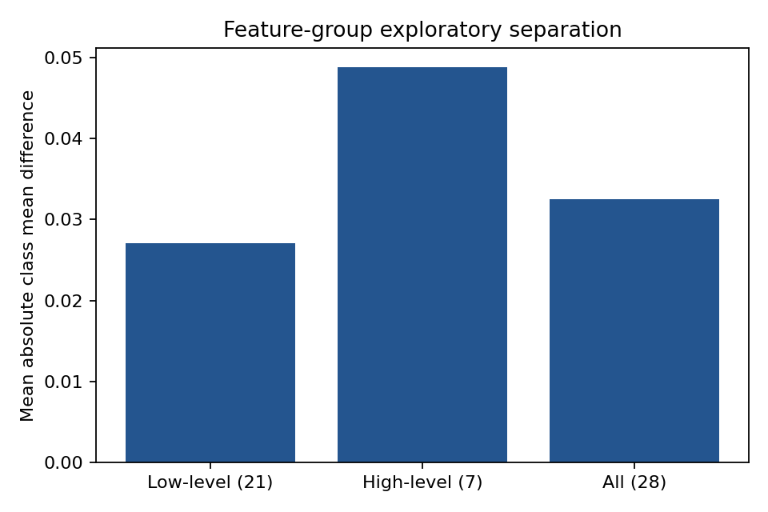

# HiggsLens: Machine-Learning Classification of Simulated HIGGS Events

**Final artifact-backed report**  
**Project team:** Saumya Mishra · Aditya Rana · Rachit Gupta · Ronit Singh · Krishna  
**Dataset:** UCI HIGGS, dataset 280  
**Source:** <https://archive.ics.uci.edu/dataset/280/higgs>  
**Generated from:** saved artifacts under `outputs/`  

> **Scientific boundary.** HIGGS is a simulated Monte Carlo benchmark. This project evaluates classification software and makes no claim of particle discovery, real-detector performance, or physical probabilities.

## 1. Executive summary

HiggsLens is a reproducible machine-learning workbench for separating simulated HIGGS signal events from simulated background events. The implementation compares Logistic Regression, XGBoost and a regularised PyTorch multilayer perceptron across 21 low-level kinematic features, 7 high-level invariant-mass features and all 28 features.

The current validated artifact registry contains **9 runs** over **250,000 recorded benchmark rows**, using the `higgs-split-v1` protocol with seed 42. The strongest currently loaded artifact is **XGBoost on `all` features**, with test ROC-AUC **0.8123**, PR-AUC **0.8266**, Brier score **0.1765**, and accuracy **0.7334**. <!-- allow-metric -->

Among all-feature runs, **XGBoost** is currently highest at ROC-AUC **0.8123**. <!-- allow-metric --> This is the report headline for the current saved registry, and it is explicitly scoped to the recorded 250,000-row benchmark. The older `outputs/full_colab_results.json` file is retained as an archival 1M reference, but it is not mixed into the headline because it uses a different pipeline/configuration and reports the same copied runtime for all three models.

## 2. Research question and scope

The central question is whether models can learn useful separation directly from low-level event kinematics, whether high-level invariant masses provide a measurable advantage, and how model family changes discrimination, calibration and compute cost.

In scope:

- Binary classification of simulated signal/background events.
- Logistic Regression, XGBoost and compact MLP models.
- Low-level, high-level and combined feature groups.
- Stratified train/validation/test evaluation with saved prediction artifacts.
- Streamlit inspection of metrics, curves, thresholds and EDA evidence.

Outside scope:

- Reproducing the 2012 Higgs discovery.
- Real detector data, significance estimates or systematic-uncertainty modelling.
- Treating classifier scores as physical probabilities.

## 3. Dataset and data card

The source is the UCI Machine Learning Repository HIGGS dataset (id 280), released under CC BY 4.0. The official archive contains approximately 11 million simulated events, one binary label and 28 inputs. The notebooks download the archive directly from the UCI URL; the repository contains code and artifacts, not the raw dataset.

| Item | Verified value |
|---|---|
| Dataset | UCI HIGGS, dataset 280 |
| Raw source URL | <https://archive.ics.uci.edu/static/public/280/higgs.zip> |
| Schema | 1 label + 28 features |
| Feature groups | 21 low-level + 7 high-level + 28 combined |
| Current saved EDA rows | 250,000 |
| Signal events in saved EDA | 131,942 (52.78%) |
| Background events in saved EDA | 118,058 (47.22%) |
| Missing values | 0 |
| Non-finite values | 0 |
| Split | 70% train / 15% validation / 15% test, seed 42 |

The exact raw-file row count and checksum should be recorded from the runtime that downloads the final archive. The saved EDA artifact is the authoritative source for the values above.

## 4. Exploratory data analysis

The EDA artifacts are generated under `outputs/eda/` and are displayed by the Dataset Observatory in Streamlit. The saved report contains feature summaries, class balance, feature distributions, group separation and correlation outputs.




The strongest saved feature correlations include `m_wbb`–`m_wwbb` (**0.895**) and `m_jj`–`m_jjj` (**0.791**). The four b-tag features have three unique values each in the saved summary and are strongly zero-inflated, which supports treating them as discrete indicators rather than smooth measurements.

## 5. Experimental protocol

The loader validates column count, numeric values, binary labels and finite feature values. A fixed seed of 42 creates a stratified `higgs-split-v1` partition. StandardScaler is fitted on training rows only for Logistic Regression and the MLP. XGBoost uses the validated feature matrix without requiring standardisation. The operating threshold is selected on validation data for a 50% signal-efficiency target, then frozen before test evaluation.

Every run exports a `metrics.json` envelope and a `test_predictions.csv` file. The dashboard reads those files and never trains a model during startup.

## 6. Models

### Logistic Regression

The linear baseline uses an L-BFGS solver with `C=1.0` and a training-only StandardScaler. It provides a fast, interpretable reference for how much separation can be obtained without nonlinear interactions.

### XGBoost

The tree ensemble uses the project’s documented XGBoost configuration: 150 estimators, maximum depth 6, learning rate 0.1, subsample 0.8, column subsample 0.8 and histogram tree construction.

### Compact MLP

The neural baseline uses hidden widths 64 and 32, BatchNorm1d, ReLU, dropout 0.20, AdamW, learning rate 1e-3, weight decay 1e-4, batch size 1024 and validation-ROC-AUC checkpointing. The saved `mlp_all` run contains genuine per-epoch history with **30 epochs**.

## 7. Current saved results

All values in the table below are computed from the current `outputs/*/metrics.json` and prediction files. Accuracy is recomputed at score threshold 0.5 from the saved test predictions.

| Model | Feature group | Features | ROC-AUC | PR-AUC | Brier | Accuracy | Time (s) |
|---|---:|---:|---:|---:|---:|---:|---:|
| XGBoost | `all` | 28 | 0.8123 | 0.8266 | 0.1765 | 0.7334 | 4.72 |
| Compact MLP | `all` | 28 | 0.8121 | 0.8270 | 0.1767 | 0.7322 | 50.22 |
| XGBoost | `high_level` | 7 | 0.7848 | 0.8026 | 0.1882 | 0.7046 | 2.44 |
| Compact MLP | `high_level` | 7 | 0.7832 | 0.8020 | 0.1892 | 0.7044 | 47.00 |
| Compact MLP | `low_level` | 21 | 0.7257 | 0.7366 | 0.2113 | 0.6650 | 47.89 |
| XGBoost | `low_level` | 21 | 0.7092 | 0.7233 | 0.2165 | 0.6512 | 4.17 |
| Logistic Regression | `all` | 28 | 0.6854 | 0.6817 | 0.2231 | 0.6439 | 0.68 |
| Logistic Regression | `high_level` | 7 | 0.6518 | 0.6217 | 0.2315 | 0.6295 | 0.32 |
| Logistic Regression | `low_level` | 21 | 0.5960 | 0.6222 | 0.2418 | 0.5680 | 0.39 |


The all-feature models are the strongest configuration for each family in the current registry. The all-feature XGBoost and MLP results are close, while the linear model remains lower. High-level features alone outperform low-level features for each family in the current saved run set, but the combined representation performs best.

## 8. Operating-point analysis

The threshold is selected on validation data rather than test data. For the current all-feature runs, the saved operating-point records show:

| Model | Validation threshold | Test signal efficiency | Test background rejection |
|---|---:|---:|---:|
| XGBoost | 0.6906 | 50.30% | 89.17% |
| Compact MLP | not recorded | not recorded | not recorded |
| Logistic Regression | 0.5796 | 50.39% | 73.84% |


Background rejection is a benchmark operating metric, not a discovery significance. The Streamlit Validation view exposes the same saved test predictions through an interactive threshold workbench.

## 9. Dashboard integration

Launch the application with:

```bash
streamlit run app/main.py
```

The dashboard now uses:

- `outputs/*/metrics.json` and `test_predictions.csv` for experiment comparison and validation plots.
- `outputs/eda/summary.json` and `feature_summary.csv` for Dataset Observatory metrics.
- Saved EDA images for class balance, distributions and correlation views.
- Genuine MLP training history when it exists in the artifact envelope.

The app reports **9 valid runs** and skips non-run folders such as `outputs/eda/` and `outputs/model_weights/` during artifact discovery.


## 10. Testing and reproducibility

The repository test suite was run after the integration changes:

```text
105 passed
```

Notebook JSON parsing, code-cell compilation and `git diff --check` also passed. The raw dataset is downloaded at runtime from UCI, and generated data/model binaries remain outside version control.

## 11. Limitations and validity threats

1. The benchmark is simulated and does not represent real detector data.
2. The benchmark class balance is approximately 53/47, unlike a real rare-event search.
3. The current results use one seed and one recorded benchmark sample.
4. The historical 1M summary was produced by a different pipeline/configuration and has a copied runtime field; it is retained for traceability but not used as the current headline.
5. The current report does not claim that the full 11-million-row training run has completed. The notebooks are configured to download the full source, while the saved artifacts in this workspace record the 250,000-row benchmark.

## 12. Conclusion

HiggsLens provides a working, artifact-backed comparison of three model families over the HIGGS feature groups. The current validated registry shows that combining the low-level and high-level inputs gives the strongest result for each family, with XGBoost and the compact MLP closely matched on all features and Logistic Regression providing a fast linear baseline. The Streamlit application now presents the same saved metrics and EDA outputs used in this report, preserving traceability from experiment files to the final presentation.

## References

1. P. Baldi, P. Sadowski and D. Whiteson, “Searching for exotic particles in high-energy physics with deep learning,” *Nature Communications*, 5, 4308, 2014. <https://www.nature.com/articles/ncomms5308>
2. D. Whiteson, “HIGGS,” UCI Machine Learning Repository, dataset 280. <https://archive.ics.uci.edu/dataset/280/higgs>
3. T. Chen and C. Guestrin, “XGBoost: A scalable tree boosting system,” KDD, 2016.
4. A. Paszke et al., “PyTorch: An imperative style, high-performance deep learning library,” NeurIPS, 2019.

## Appendix: artifact paths

- `outputs/eda/summary.json`
- `outputs/eda/feature_summary.csv`
- `outputs/eda/feature_distributions.png`
- `outputs/eda/correlation_heatmap.png`
- `outputs/experiments.json`
- `outputs/mlp_*/metrics.json`
- `outputs/logreg_*/metrics.json`
- `outputs/xgboost_*/metrics.json`
